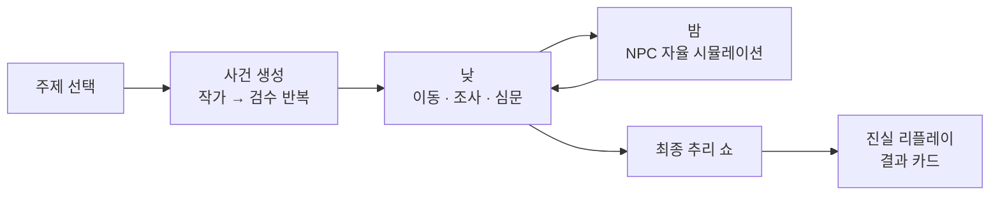
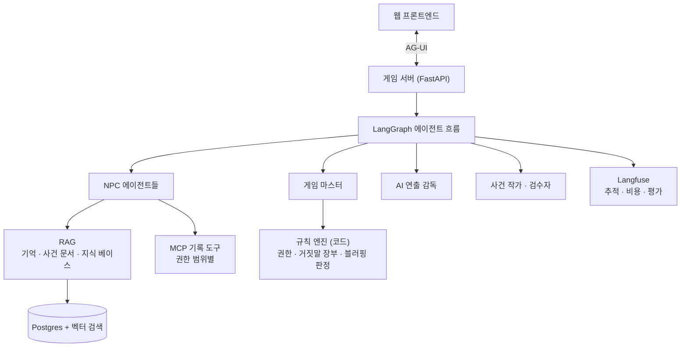

# The Suspects

> 스스로 움직이는 AI 용의자들을 심문해 범인을 찾는 추리 게임
> RAG · LangGraph 기반 **자율형 멀티 에이전트** 프로젝트


> **현재 기획 단계입니다.** 아래 내용은 [PRD](./PRD.md) 기준 설계이며, 개발이 진행되면 실제 구현과 측정 결과로 채워 나갑니다.

---

## 소개

플레이어는 형사가 되어 아파트, 회사 같은 현대 배경의 사건 현장에 들어갑니다. 용의자 한 명 한 명이 **독립된 AI 에이전트**로, 각자 성격과 목표와 숨기고 싶은 비밀과 기억을 갖고 있습니다.

용의자들은 플레이어를 기다리지 않습니다. 플레이어가 없는 밤에도 서로 만나 말을 맞추고, 소문을 퍼뜨리고, 증거를 숨기려 합니다. 플레이어는 자유로운 대화와 현장 조사로 단서를 모아 그 거짓말을 깨야 합니다.

## 이런 게임이에요

- **매번 새로운 사건:** 주제를 고르거나 직접 입력하면 사건, 인물, 배경, 스토리가 새로 만들어집니다. 같은 사건은 다시 나오지 않습니다.
- **스스로 움직이는 용의자:** 5~10명의 용의자가 자기 판단으로 이동하고, 서로 대화하고, 수사에 반응합니다.
- **대화와 조사:** 지도 이동, 현장 조사, 증거 제시는 클릭으로, 심문은 자유 대화로 진행합니다.
- **심리전:** 증거 카드를 근거로 거는 블러핑(증거가 충분할 때만 통함), 시간이 지나면 흐려지고 소문에 오염되는 증인의 기억, 형사의 평판과 소문.
- **공정한 추리:** 모든 사건은 반드시 풀 수 있게 검수되고, 범인의 거짓말에는 반드시 반박할 증거가 있습니다.
- **클라이맥스:** 용의자를 모두 모아 놓고 증거로 범인을 무너뜨리는 최종 추리 쇼, 그리고 그동안 용의자들이 실제로 무엇을 했는지 보여 주는 진실 리플레이.

## 왜 만들었나

LLM으로 NPC를 움직이는 추리 게임은 이미 있습니다. 하지만 대표적인 사례(Vaudeville, 2023)는 NPC가 질문을 피하거나 답이 오락가락해서 추리가 답답하다는 평가를 받았습니다.

**The Suspects의 목표는 "공정하게 풀리는 AI 추리 게임"입니다.** 이를 위해 사건의 진실을 고정한 사건 원본, 범인의 거짓말을 관리하는 거짓말 장부, NPC의 발언을 검사하는 게임 마스터, 그리고 중요한 판정은 LLM이 아닌 코드가 하는 구조를 설계했습니다.

## 게임 속 기술, 실무에서는

게임은 기술을 보여 주는 무대입니다. 게임의 기능 하나하나가 기업용 AI의 실제 문제와 그대로 짝지어집니다.

| 게임에서 | 실무에서는 |
|:--|:--|
| NPC마다 볼 수 있는 기록이 다름 | 사내 문서 RAG에서 직급·부서별로 볼 수 있는 문서가 다른 문제 |
| 게임 마스터가 NPC의 거짓 사실을 차단 | 고객 상담 봇의 환각 차단 |
| 수첩 단서에 출처 연결, 법 조문 존재 검증 | 근거와 인용을 붙이는 기업용 AI 답변 |
| NPC들이 알아서 움직이고 대화 | 여러 에이전트가 협업하고 서로 검증하는 자동화 |
| 사건 원본으로 검색 정답을 자동 생성해 평가 | RAG 품질을 숫자로 관리하는 LLMOps |
| 판당 비용과 응답 속도 측정 | AI 서비스 운영 비용과 성능 관리 |
| 탈옥 시도 방어 | 프롬프트 인젝션 보안 |

## 자율형 멀티 에이전트

LangGraph는 흐름의 틀만 잡고, **무엇을 할지는 각 에이전트가 스스로 판단**합니다.

| 에이전트 | 스스로 판단하는 것 |
|:--|:--|
| 용의자 NPC (5~10명) | 무엇을 말하고 숨길지, 밤에 어디로 가서 누구를 만날지, 증거를 숨길지 |
| 사건 작가 · 검수자 | 사건을 설계하고, 풀 수 없으면 스스로 다시 설계 |
| AI 연출 감독 | 플레이어의 진행 상황을 보고 언제 무슨 사건을 터뜨릴지 |
| 파트너 형사 | 부탁받은 조사에 어떤 기록 도구를 쓸지 |
| 게임 마스터 | NPC 발언과 행동이 사건의 진실과 규칙을 지키는지 검사 |
| 탐정 자동 플레이 에이전트 | 사람 없이 사건을 풀어 보며 풀 수 있는 사건인지 검증 |

**아무도 대본을 쓰지 않은 전개 (예시)**
1. 낮에 형사가 경비원에게 "302호 어때요?"라고 묻습니다.
2. 밤에 경비원이 이웃에게 "형사가 302호를 캐더라"고 말합니다.
3. 소문이 302호, 즉 범인에게 들어갑니다.
4. 범인은 공범에게 전화하고 메신저 기록을 지우려 합니다.
5. 다음 날 공범의 진술이 미묘하게 달라져 있고, 두 사람의 통화 기록이 남아 있습니다.

자율은 규칙 안에서만 허용됩니다. 사건 당일의 진실은 바뀌지 않고, 행동은 정해진 목록 안에서 고르며, 게임 마스터와 코드 규칙이 자율이 사건을 망치지 않게 지킵니다.

## 한 판의 흐름



## 아키텍처



## 사용 기술 (계획)

개발이 진행되면 실제로 쓴 라이브러리와 버전으로 갱신합니다.

### AI · 에이전트

| 기술 | 이 프로젝트에서 하는 일 |
|:--|:--|
| **LangGraph** | 에이전트 흐름 5개(사건 생성, 플레이어 행동·심문, 밤 시뮬레이션, AI 연출 감독, 최종 추리 쇼). 조건 분기, 반복, 서브그래프, 병렬 실행(Send), 플레이어 차례 대기(interrupt), 세이브(checkpointer) |
| **LangChain 1.0** | 역할별 LLM 교체, 구조화 출력(Pydantic), 대체 모델 자동 전환, 검색기·임베딩 연결, MCP 어댑터. 미들웨어로 개인정보 마스킹(규칙 기반)과 대화 요약(비동기), 파트너 형사는 `create_agent` |
| **RAG** | NPC 기억 검색, 권한 필터, 기억 왜곡(확신도·출처), 사건 문서와 지식 베이스 검색, 출처 연결 |
| **OpenRouter** | 여러 회사의 LLM을 같은 방식으로 호출. 초저가 모델로도 돌아가게 설계하고, 역할별로 품질·속도에 맞는 모델 선택 |
| **Agent Skills** | 필요할 때만 불러오는 노하우 폴더(SKILL.md). 아래 [스킬](#스킬) 참고 |
| **MCP** | 게임 속 기록 시스템 도구와 외부 클라이언트용 게임 서버. 아래 [MCP](#mcp) 참고 |
| 구조화 출력 · 도구 호출 | 라우터 의도 분류, NPC 행동 선택, 감정 태그, 블러핑 주장 추출 |
| 가드레일 | 부적절한 주제·입력·출력 차단, 프롬프트 인젝션 탐지. 큰 LLM 대신 소형 분류 모델을 검색과 병렬로 돌리고, NPC 답변은 문장 단위로 검사 |
| 하이브리드 검색 · 재정렬 | 키워드 + 벡터 검색, 상위 후보 재정렬 |
| 이미지 생성 모델 | 장소별 배경을 판마다 새로 생성 |
| **AG-UI** | 에이전트와 웹 화면 사이의 표준 이벤트 스트림. NPC 대사 토큰, 감정 태그, 상태 변화분, 연출 이벤트. `ag-ui-langgraph`로 LangGraph를 FastAPI 엔드포인트에 연결 |
| **시맨틱 라우터** | 입력 의도를 LLM 대신 임베딩 유사도로 수십 ms 안에 분류하고, 애매할 때만 LLM으로 |
| **Contextual Retrieval** | 청크마다 문맥 설명을 붙여 검색 정확도 향상. 사건 문서는 생성할 때 문맥 설명을 함께 써서 추가 호출 없음 |
| **스스로 배우는 스킬** | 탐정 에이전트의 수사 요령, 사건 작가의 실패 노트를 플레이가 끝날 때마다 스킬로 갱신 |
| 시간 관계 그래프 | "누가 언제 누구에게서 무엇을 들었나"를 Postgres 관계 테이블로 기록. 소문 추적과 진실 리플레이에 사용 |
| A2A (선택) | 탐정 자동 플레이 에이전트와 역할 반전 모드의 AI 형사를 외부 에이전트에게 공개 |
| 역할별 effort · 난이도 분기 | 짧은 작업은 낮은 추론 깊이로 빠르게, 시맨틱 라우터가 "어려움"으로 분류한 질문만 상위 모델로 |
| 프롬프트 캐싱 규칙 | 바뀌지 않는 설정부터 쌓아 캐시 적중률을 높이고, 적중률을 지표로 관리 |

### 운영 · 평가

| 기술 | 이 프로젝트에서 하는 일 |
|:--|:--|
| **Langfuse** | 모든 에이전트 호출 추적, 판당 비용과 응답 지연, 프롬프트 버전 관리, 모델 선발전 데이터셋과 실험, 실서비스 표본 평가 |
| **G-Eval (DeepEval)** | 캐릭터 일관성, 말투 유지, 정보 누출 여부를 기준표로 채점 |
| **RAGAS** | NPC 답변이 검색한 근거에 기반했는지(근거성) |
| **Promptfoo** | 탈옥 공격 세트, 프롬프트 변경 회귀 테스트 |
| 검색 평가 (Recall@k, MRR) | 사건 원본에서 자동 생성한 정답으로 검색 품질 측정 |
| GitHub Actions | 코드를 바꿀 때마다 테스트와 평가 자동 실행 |
| **AI 플레이어 시뮬레이터** | 성실형, 엉뚱한 말만 하는 형, 탈옥 시도형 같은 AI 플레이어로 자동 플레이 테스트 |
| **에이전트 궤적 평가** | 최종 결과뿐 아니라 에이전트가 거쳐 간 과정(도구 사용, 헛걸음, 근거 없는 발언)을 평가 |
| **DSPy** | 평가 점수를 목표로 프롬프트를 자동 최적화해 초저가 모델의 품질을 끌어올림 |
| **OpenTelemetry GenAI** | 추적 데이터를 표준 형식으로 남겨 Langfuse로 전송. 외부 MCP 요청의 `traceparent`도 이어받아 한 추적으로 연결 |
| 비용 6갈래 집계 · 코드 상한 | NPC, 게임 마스터, 밤 시뮬레이션, 사건 생성, 이미지, 검색으로 비용과 지연을 나눠 재고, 상한은 코드로 막음 |
| 주간 LLMOps 리포트 | GitHub Actions가 매주 비용, 지연, 막힌 지점, 평가 점수를 정리해 기록 |

### 서비스

| 기술 | 이 프로젝트에서 하는 일 |
|:--|:--|
| Python, FastAPI | 게임 서버, 스트리밍(SSE), 백그라운드 작업(사건 생성, 밤 시뮬레이션) |
| 웹 프론트엔드 (TypeScript) | 노드형 지도, 수첩, 추리 보드, 연출 효과, 결과 카드 |
| 절차적 캐릭터 (SVG) | 랜덤 숫자(시드) 하나로 매번 다른 얼굴과 옷을 코드로 그림. 표정과 입 모양 애니메이션 |
| Postgres + 벡터 확장 | 게임 상태, 세이브 슬롯, NPC 기억, 기록, 벡터 검색 |
| 오브젝트 스토리지 | 판마다 생성한 배경 그림 (클리어 시 삭제) |
| Faker | 사건과 무관한 잡음 기록(수천 건의 출입 기록 등) 생성 |

### 최신 기술은 속도 기준으로 골랐습니다

최신 기술을 많이 넣는 것보다, **플레이어가 기다리는 응답 경로를 느리게 만들지 않는 것**을 기준으로 골랐습니다. 플레이 밖(색인, 사건 생성, 평가)에서 도는 기술은 적극적으로 넣고, 응답 경로에 끼어드는 기술은 방식을 바꾸거나 뺐습니다. 모든 기술은 적용 전후의 지연 시간과 품질을 측정해 기록합니다.

| 판단 | 기술 |
|:--|:--|
| ✅ 넣음 | AG-UI, 시맨틱 라우터, Contextual Retrieval, MCP Apps, 스스로 배우는 스킬, AI 플레이어 시뮬레이터와 궤적 평가, DSPy, OpenTelemetry |
| ⚠️ 방식을 바꿔 넣음 | LangChain 1.0 미들웨어(규칙 기반, 비동기), create_agent(열린 판단이 필요한 곳만), 경량 가드레일(병렬 실행), 시간 관계 그래프(외부 도구 대신 자체 테이블), A2A(외부 경계에서만), MCP Elicitation(지원 클라이언트에서만), MCP Tasks(SDK 지원 전까지 상태 조회 방식) |
| ❌ 뺌 | 브라우저 안 소형 모델(첫 로딩이 길고 기기마다 다름), Deep Agents(LLM 호출이 늘어 사건 생성이 느려짐) |

권한 필터, 맥락 압축, 스킬 점진 로딩, 대화 요약으로 LLM에 넣는 정보를 필요한 것만 짧게 유지하는 **컨텍스트 엔지니어링**도 속도 전략의 핵심입니다.

### 설계 원칙

- **핫 패스 LLM 1회:** 플레이어가 질문하고 기다리는 동안 부르는 LLM은 NPC 답변 1회가 기본입니다. 예외(애매한 입력의 LLM 분류, 위험한 답변의 LLM 검사)는 발생 비율을 지표로 관리합니다.
- **판정은 코드, 연기는 LLM:** 블러핑 성공, 영장 승인, 평판, 기억 확신도, 최종 추리 판정은 모두 코드가 계산합니다. 블러핑도 자유 입력 대신 버튼과 증거 카드로 받아 LLM 호출을 줄였습니다.
- **LLM 출력 3종 안전장치:** 모든 LLM 출력은 구조화 출력, 코드 검증, 재시도 상한으로 감쌉니다.
- **조건부 경로는 기본 끔:** 질의 재작성, 재정렬처럼 지연을 더하는 기능은 측정으로 효과가 확인될 때만 켭니다.
- **수치는 설정으로:** 평판, 블러핑 가중치, 영장 기준, 연출 감독 트리거 같은 게임 수치는 전부 설정 파일에 두고 플레이테스트로 조정합니다.
- **대체 경로 준비:** 라이브러리마다 버전, 확인일, 실패 시 대체 방법을 표로 관리하고, 0.0.x 버전은 CI 스모크 테스트로 지킵니다.

설계는 외부 에이전트가 쓴 검토 문서 2개(추가 기능 제안, 구현 가능성 평가)를 하나씩 사실 확인한 뒤 맞는 것만 채택해 보강했습니다. 채택하지 않은 제안과 이유도 [PRD 부록 D](./PRD.md)에 남겨 두었습니다.

## 스킬

에이전트는 평소에 스킬 목록(이름과 설명)만 보고 있다가, 필요한 스킬의 본문만 불러옵니다. 프롬프트가 짧아지고, 새 사건 유형이나 이벤트를 코드 수정 없이 폴더 추가만으로 늘릴 수 있습니다.

- **스킬**은 "어떻게 행동하나"(행동 방식), **지식 베이스(RAG)**는 "사실 지식"(직무 내용, 법 조문)을 맡습니다.
- 사건 뼈대처럼 랜덤으로 정하는 스킬은 코드가 골라 불러오고, 판단이 필요한 경우에만 LLM이 고릅니다.

### 게임 안 에이전트가 쓰는 스킬

| 스킬 | 쓰는 에이전트 | 내용 |
|:--|:--|:--|
| `case-skeletons/locked-room` | 사건 작가 | 밀실형 사건 설계 |
| `case-skeletons/alibi` | 사건 작가 | 알리바이형 사건 설계 |
| `case-skeletons/insider` | 사건 작가 | 내부자형 사건 설계 |
| `modernize-theme` | 사건 작가 | 자유 주제를 현대 배경으로 바꾸기 |
| `verify/mmo-checklist` | 검수자 | 동기·수단·기회 점검표 |
| `verify/no-perfect-crime` | 검수자 | 지워진 증거마다 간접 흔적이 남는지 점검 |
| `roles/security-guard` | NPC | 경비원의 행동 방식과 말투 지침 |
| `roles/dba` | NPC | DB 관리자의 행동 방식과 말투 지침 |
| `roles/cleaner` | NPC | 청소원의 행동 방식과 말투 지침 |
| `roles/*` | NPC | 역할이 늘어나면 폴더 추가 |
| `events/confrontation` | AI 연출 감독 | 대질 심문 진행법 |
| `events/threat-message` | AI 연출 감독 | 범인의 협박 문자 |
| `events/blackout` | AI 연출 감독 | 정전 같은 생활 돌발 이벤트 |
| `events/deal-offer` | AI 연출 감독 | NPC의 거래 제안 |
| `detective/strategy` | 탐정 자동 플레이 에이전트 | 수사 전략. **사건을 풀 때마다 효과 있던 요령을 스스로 갱신** |
| `writer/failure-notes` | 사건 작가 | 검수에서 자주 떨어지는 패턴 정리. **검수 결과를 보고 스스로 갱신** |

`detective/strategy`와 `writer/failure-notes`는 헤르메스 에이전트처럼 경험에서 스스로 배우는 스킬입니다. 특정 사건의 내용은 남기지 않고 일반화된 요령만 남기며, 갱신 후 성능이 나빠지면 이전 버전으로 되돌립니다.

### 개발할 때 쓰는 스킬

AI 코딩 에이전트가 매번 같은 규칙으로 작업하도록 저장소 안에 둡니다(`.agents/skills/`).

| 스킬 | 내용 |
|:--|:--|
| 새 이벤트 추가 | 이벤트 스킬 작성, 연출 감독 등록, 테스트 추가 절차 |
| 새 역할 추가 | 역할 스킬 작성법과 지식 베이스 연결 |
| 평가 실행 | 단위 테스트, 검색 평가, G-Eval, 탈옥 세트 실행과 리포트 |
| 프롬프트 작성 규칙 | 짧게, 호출 하나에 일 하나, 범인 정보 금지 등 |
| ADR 작성 | 의사결정 기록 양식 |

## MCP

MCP 서버는 두 종류로 나눕니다. 외부로 여는 것은 게임 MCP 서버 하나뿐이고, 기록 시스템 MCP는 게임 서버 안에서만 씁니다(속도와 보안).

### 1. 게임 MCP 서버 (외부용)

데스크톱 AI 어시스턴트 같은 MCP 클라이언트에서 채팅으로 게임을 플레이하거나, 외부 AI 에이전트가 자동으로 수백 판을 플레이하며 풀이율을 재는 데 씁니다.

MCP 최신 스펙(2026-07-28)의 기능은 SDK와 클라이언트 지원을 확인한 뒤(2026-10-12) 골라서 씁니다.

| 기능 | 지원 현황 | 이 프로젝트에서 |
|:--|:--|:--|
| **MCP Apps** | 공식 Python SDK v2와 주요 AI 어시스턴트 웹·데스크톱 앱, VS Code Copilot, ChatGPT, Cursor 등 지원 | 지도, 수첩, 증거 카드 화면을 MCP 클라이언트 안에서 보여 줍니다 |
| **Elicitation** | SDK는 지원, 일부 CLI 코딩 에이전트는 지원, 주요 AI 어시스턴트 웹·데스크톱 앱은 미지원 | 지원하는 클라이언트에서만 쓰고, 나머지는 MCP Apps 폼으로 입력을 받습니다 |
| **Tasks** | 공식 Python SDK 미구현 | 사건 ID를 바로 돌려주고 `get_case_status`로 진행 상황을 조회하는 방식으로 대신합니다 |

- **캐시 힌트:** 도구 목록처럼 누구에게나 같은 결과는 짧게 캐시하고(`ttlMs`, `cacheScope: public`), 수첩처럼 사람마다 다른 결과는 캐시하지 않습니다.
- **추적 연결:** 외부 클라이언트가 보낸 `traceparent`를 이어받아, 외부 에이전트의 호출부터 서버 안 에이전트 호출까지 Langfuse에서 한 줄로 이어 봅니다.
- **호출 상한:** 토큰별 하루 호출 수, 동시 진행 판 수, 하루 사건 생성 수를 코드로 제한합니다.
- **Agent Plugins (선택):** 게임 MCP 서버 설정과 탐정 수사 전략 스킬을 Agent Plugins 1.0 형식으로 묶어, 외부 에이전트가 설치 한 번으로 플레이할 수 있게 합니다.
- **Skills over MCP (선택):** 외부에 공개해도 되는 `detective/strategy` 스킬만 MCP로 공개합니다.

| 도구 | 하는 일 |
|:--|:--|
| `start_case` | 주제를 정해 새 사건 시작. 사건 ID를 바로 돌려주고 생성은 백그라운드에서 진행 |
| `get_case_status` | 사건 생성 진행 상황 조회 |
| `move` | 장소 이동 |
| `investigate` | 현장 조사 |
| `ask_npc` | NPC에게 질문 |
| `present_evidence` | 증거 제시 |
| `request_warrant` | 영장 신청 |
| `get_notebook` | 수첩 보기 |
| `accuse` | 범인 지목 |

- 사건의 정답이 새는 도구(사건 원본 보기 등)는 넣지 않습니다. 디버그용 도구는 개발 모드 전용 서버로 분리합니다.
- 인증과 호출 횟수 제한을 둡니다.

### 2. 기록 시스템 MCP 서버 (내부용)

게임 속 기록 시스템을 에이전트별 권한 범위가 있는 도구로 만듭니다. 정형 기록은 매개변수가 정해진 SQL로 조회합니다(자유 SQL은 허용하지 않음).

| 도구 | 하는 일 | 쓸 수 있는 주체 |
|:--|:--|:--|
| `search_access_log` | 장소·시간·인물 조건으로 출입 기록 조회 | 관리소장, 경비원, 형사 |
| `search_cctv_log` | 장소·시간 조건으로 CCTV 기록 조회 | 관리소장, 경비원, 형사 |
| `search_messages` | 단톡방·사내 메신저 검색 | 참여자 본인, 형사(공개 채널) |
| `search_documents` | 위키, 매뉴얼, 회의록 같은 긴 문서 검색 (RAG) | 문서 접근 권한이 있는 NPC, 형사, 파트너 |
| `get_bank_transactions` | 계좌 거래 내역 조회 | 은행원, 형사(영장 필요) |
| `get_call_records` | 통화 기록 조회 | 형사(영장 필요) |

- 영장이 승인되면 형사의 권한 범위가 넓어집니다.
- 파트너 형사는 형사의 현재 권한 안에서 대신 조회합니다.
- LangChain MCP 어댑터로 LangGraph 에이전트에 연결합니다.

### 3. A2A (선택)

에이전트끼리 작업을 주고받는 표준 프로토콜인 A2A로, 탐정 자동 플레이 에이전트와 역할 반전 모드의 AI 형사를 외부 에이전트에게 공개합니다. 내부 NPC끼리의 통신에는 쓰지 않습니다(네트워크 왕복으로 느려지기 때문).

## RAG 파이프라인

```
수집 → 파싱 → 정제 → 청킹 → 메타데이터 → 임베딩 → 색인(벡터 + 키워드 + SQL)
질문 → 질의 재작성 · 조건 추출 → 권한 필터 검색 → 재정렬 · 압축 → 근거 기반 답변 → 출처 연결
```

- **실제 공개 데이터 지식 베이스:** 직업 정보와 법령 조문을 수집·정제해 NPC의 직업 지식과 사건 종결 보고서의 법 조문 인용에 씁니다.
- **문서 종류별 청킹:** 매뉴얼은 제목 구조, 대화 로그는 시간 단위, 법령은 조문 단위로 나눕니다.
- **Contextual Retrieval:** 청크마다 "이 청크는 ○○ 매뉴얼의 백업 정책 부분" 같은 문맥 설명을 붙여 임베딩합니다.
- **시맨틱 라우터:** 검색에 쓰는 임베딩을 그대로 활용해 입력 의도를 빠르게 분류합니다.
- **권한 필터:** 각 NPC는 자기가 알 수 있는 기록만 검색합니다. 프롬프트가 아니라 검색 단계에서 코드로 막습니다.
- **정형 기록은 SQL, 서술형은 벡터 검색:** 출입 기록처럼 정확한 조건이 필요한 검색은 SQL 도구로 합니다.
- **정답 기반 평가:** 사건 원본이 있어서 "이 질문에 나와야 할 문서"를 자동으로 만들 수 있고, Recall@k와 MRR로 검색 품질을 정확히 잽니다.

## 평가 (측정 예정)

개발이 진행되면 실측 수치로 채웁니다.

| 지표 | 목표 | 결과 |
|:--|:--|:--|
| 풀이율 (탐정 자동 플레이) | 95% 이상 | - |
| NPC 모순률 | 5% 이하 | - |
| 탈옥 공격 정보 누출 | 0건 | - |
| 검색 Recall@5 | 0.85 이상 | - |
| 인용 정확도 | 100% | - |
| 질문 응답 지연 p50 / p95 | 3초 / 6초 이하 | - |
| 시맨틱 라우터 분류 지연 | 0.05초 이하 | - |
| 질문당 핫 패스 LLM 호출 수 | 평균 1.2회 이하 | - |
| 시맨틱 라우터 정확도 / LLM으로 넘어간 비율 | 90% 이상 / 15% 이하 | - |
| 추측 생성 적중률 | 50% 이상 | - |
| 클리어 후 사건 데이터 조회 | 0건 | - |

- 탐정 자동 플레이 에이전트와 AI 플레이어 시뮬레이터로 수백 판을 자동으로 돌려 측정합니다.
- 최신 기술은 하나씩 적용 전후를 비교해 효과를 기록합니다(예: Contextual Retrieval 적용 전후 Recall@5).
- 평가는 정해진 순서로 엽니다: 검색 정답 생성 → Recall@k·MRR → 라우터 정확도 → G-Eval 표본 → 탈옥 0건 → AI 플레이어 시뮬레이터 → DSPy 최적화.
- 전수 LLM 채점은 하지 않습니다. 코드로 먼저 거르고, 싼 모델로 표본만 채점합니다.

## 로드맵

- [ ] **Phase 0** 뼈대: 저장소 구조, 모델 설정, Langfuse 연결, 모델 선발전 환경, AGENTS.md, 의존성 표, 게임 수치 설정
- [ ] **Phase 1** MVP: 고정 사건 1개로 심문, 게임 마스터, 밤 시뮬레이션, 범인 지목, 저장까지 한 판 완주
- [ ] **Phase 2** 사건 생성과 시각: 사건 자동 생성·검수, 랜덤 용의자, 절차적 캐릭터, 배경 생성, 지식 베이스, 검색 평가
- [ ] **Phase 3** 심리전: 블러핑, 기억 왜곡, 평판과 소문, AI 연출 감독, 최종 추리 쇼, 진실 리플레이, 결과 카드
- [ ] **Phase 4** 확장: 대질 심문, 범인의 반격, 역할 반전 모드, 자유 주제, MCP 게임 서버, 속도 최적화, RAG 비교 실험
- [ ] **Phase 5** 향후: 멀티플레이

## 문서

- [PRD (제품 요구사항 문서)](./PRD.md): 전체 설계, 규칙, 데이터 스키마, 로드맵
- `docs/adr/`: 의사결정 기록 (개발하면서 작성 예정)
- `docs/dependencies.md`: 라이브러리별 버전, 확인일, 대체 방법 (작성 예정)
- `AGENTS.md`: 코딩 에이전트 공통 개발 규칙 (작성 예정)
- PRD 부록 F: 게임 수치 초기값 (평판, 블러핑, 영장, 기억 확신도, 연출 감독, 판정표 등)

## 참고

- Park et al., *Generative Agents: Interactive Simulacra of Human Behavior* (2023) — NPC 기억과 자율 행동 설계의 근거
- *Database Detective: Minor Crimes Division* (2026) — 기록을 뒤져 범인을 찾는 구조에서 영감
- *Vaudeville* (2023) — AI NPC 추리 게임의 선례이자 해결하려는 문제

## 라이선스

미정
