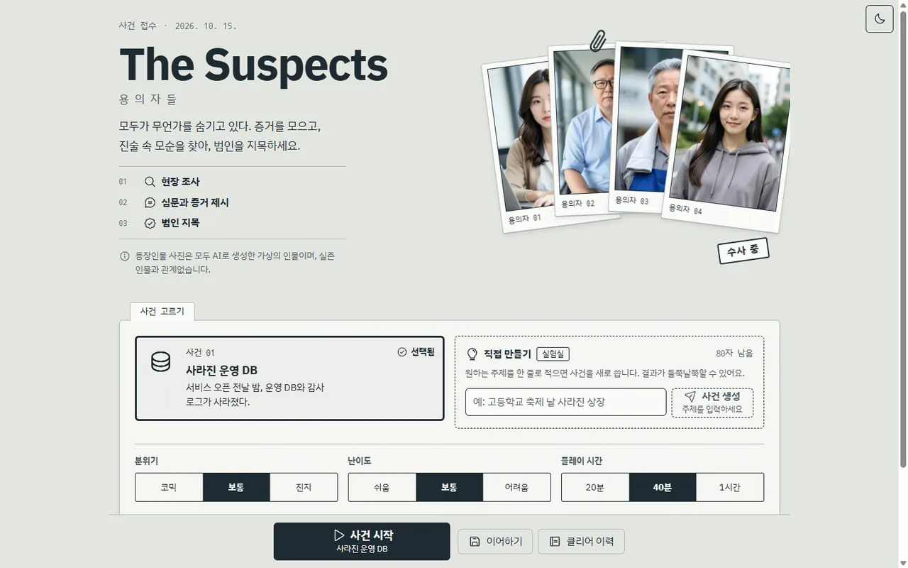
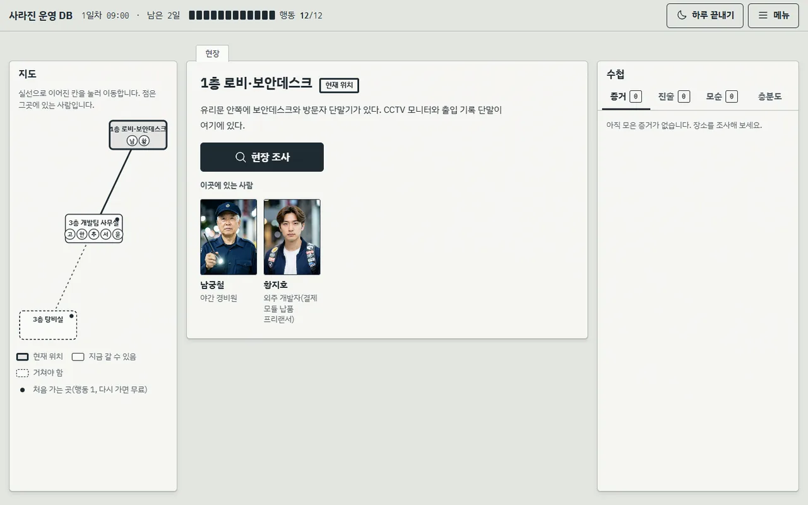
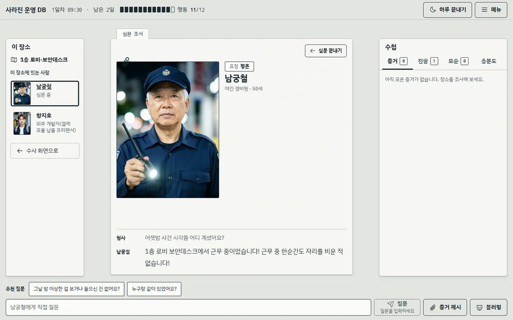
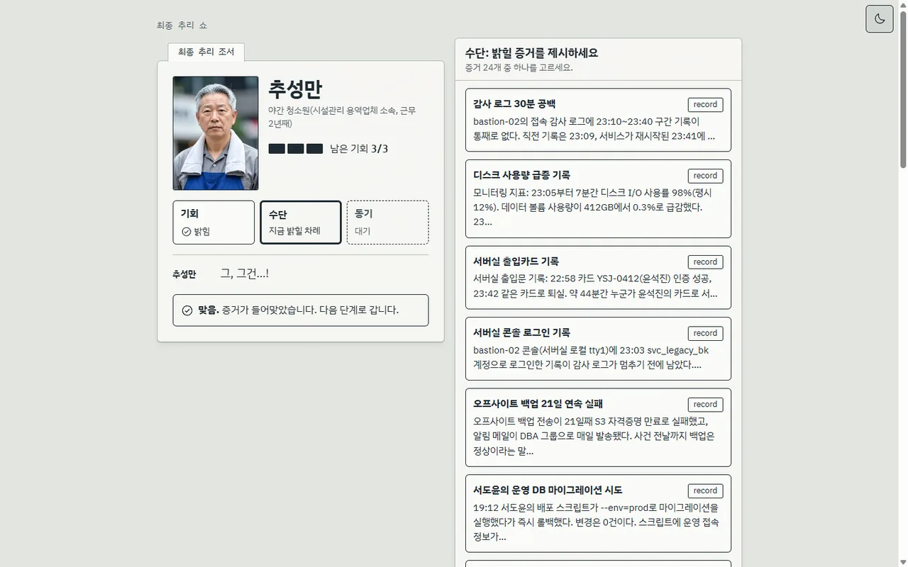
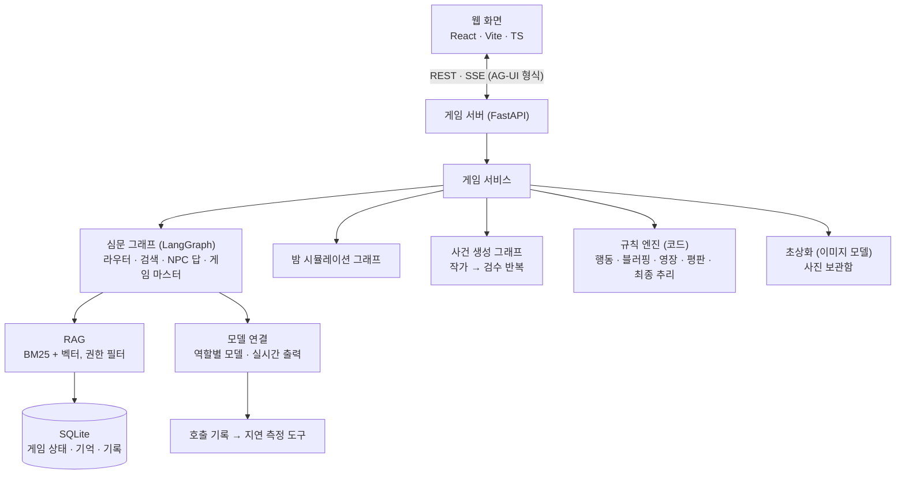

# The Suspects

> 스스로 움직이는 AI 용의자들을 심문해 범인을 찾는 추리 게임
> RAG · LangGraph 기반 **자율형 멀티 에이전트** 프로젝트


> **지금은 한 판을 처음부터 끝까지 플레이할 수 있는 MVP 단계입니다.** 고정 사건 1개와 자유 주제 사건 생성,
> 심문·밤 시뮬레이션·최종 추리 쇼가 실제 모델로 돌아갑니다. 전체 설계는 [PRD](./PRD.md), 측정 기록은 [evals/reports](./evals/reports/README.md)에 있습니다.


*증거를 내밀자 범인의 표정 사진이 바뀌고, 진술과 증거가 어긋난 곳에 "모순" 도장이 찍힌다. 범인은 깨진 거짓말만 인정하고 나머지는 끝까지 숨긴다.*

---

## 소개

플레이어는 형사가 되어 회사·아파트 같은 현대 배경의 사건 현장에 들어갑니다. 용의자 한 명 한 명이 **독립된 AI 에이전트**로, 각자 성격과 말투와 숨기고 싶은 비밀과 기억을 갖고 있습니다.

용의자들은 플레이어를 기다리지 않습니다. 밤이 되면 서로 만나 말을 맞추고 소문을 퍼뜨립니다. 플레이어는 현장 조사와 자유로운 대화로 단서를 모아 그 거짓말을 깨야 합니다.

## 화면

| 사건 고르기 | 브리핑 (용의자 소개) |
|:--:|:--:|
|  |  |
| **현장 조사** (지도 · 장소 · 수첩) | **심문** (답이 첫 문장부터 흘러나옴) |
|  |  |
| **최종 추리: 범인 지목** | **최종 추리: 기회 · 수단 · 동기 증거** |
|  |  |

<p align="center"><br><em>휴대폰 화면</em></p>

- 등장인물 사진은 모두 AI로 생성한 가상의 인물입니다(실존 인물과 관계없음). 그림을 못 그리면 코드로 그린 얼굴(SVG)로 대신합니다.
- 화면은 "수사 기록철" 콘셉트(조서·도장·포스트잇)로 만들었고 밝은/어두운 테마와 휴대폰 화면을 지원합니다.

## 이런 게임이에요

- **매번 새로운 사건:** 고정 사건 외에 주제를 한 줄로 적으면 사건, 인물, 증거, 거짓말, 기억이 새로 만들어집니다(약 90초).
- **스스로 움직이는 용의자:** 낮에는 자기 성격과 기억대로 답하고, 밤에는 서로 만나 대화하며 소문이 퍼집니다.
- **대화와 조사:** 지도 이동·현장 조사·증거 제시는 클릭으로, 심문은 추천 질문 또는 자유 입력으로 합니다.
- **심리전:** 증거 카드를 근거로 거는 블러핑(코드가 판정), 시간이 지나면 흐려지고 소문에 오염되는 기억, 형사의 평판.
- **공정한 추리:** 사건은 반드시 풀 수 있게 검수되고, 범인의 거짓말마다 반박 증거가 있습니다.
- **클라이맥스:** 범인을 지목하고 기회·수단·동기를 증거로 밝히는 최종 추리 쇼, 그동안 실제로 무슨 일이 있었는지 보여 주는 진실 리플레이와 결과 카드.

## 왜 만들었나

LLM으로 NPC를 움직이는 추리 게임은 이미 있습니다. 하지만 대표적인 사례(Vaudeville, 2023)는 NPC가 질문을 피하거나 답이 오락가락해서 추리가 답답하다는 평가를 받았습니다.

**The Suspects의 목표는 "공정하게 풀리는 AI 추리 게임"입니다.** 사건의 진실을 고정한 사건 원본, 범인의 거짓말을 관리하는 거짓말 장부, NPC 발언을 검사하는 게임 마스터, 그리고 중요한 판정은 LLM이 아닌 코드가 하는 구조로 만들었습니다.

## 게임 속 기술, 실무에서는

| 게임에서 | 실무에서는 |
|:--|:--|
| NPC마다 볼 수 있는 기억·기록이 다름(검색 단계 권한 필터) | 사내 문서 RAG에서 직급·부서별로 볼 수 있는 문서가 다른 문제 |
| 게임 마스터가 NPC의 근거 없는 말과 숨길 진실 누설을 차단 | 고객 상담 봇의 환각·정보 유출 차단 |
| 수첩 진술에 출처 연결 | 근거와 인용을 붙이는 기업용 AI 답변 |
| NPC들이 밤에 알아서 움직이고 대화 | 여러 에이전트가 협업하고 서로 검증하는 자동화 |
| 사건 원본으로 검색 정답을 자동 생성해 평가 | RAG 품질을 숫자로 관리하는 LLMOps |
| 응답 속도를 단계별로 재고 개선 전후를 기록 | AI 서비스 지연·비용 관리 |
| 탈옥 공격 세트로 누출 측정 | 프롬프트 인젝션 보안 |

## 지금 돌아가는 것

| 영역 | 구현 |
|:--|:--|
| 심문 그래프 (LangGraph) | 규칙 → 시맨틱 라우터(글자 n-gram) → 애매할 때만 LLM 분류. 권한 필터 검색 → NPC 답(LLM 1회) → 게임 마스터 2단 검사(코드 신호 → 조건부 LLM) → 수첩·기억 갱신 |
| 거짓말 장부 | 범인·공범은 숨길 주제와 그때 할 말을 늘 알고, 증거로 깨지기 전에는 진실을 꺼내지 않음. 게임 마스터가 누설 신호를 검사 |
| 밤 시뮬레이션 (LangGraph) | NPC끼리 동시에 만나 대화, 소문과 기억 오염 |
| 수사 | 노드형 지도(처음 가는 곳만 행동 소모), 점진적 증거, 증거 제시와 모순 판정, 블러핑, 영장, 평판, 연출 감독(코드), 힌트 |
| 최종 추리 쇼 | 범인 지목 → 기회·수단·동기 증거(기회 3번), 무고한 사람 지목 시 반박, 진실 리플레이, 결과 카드 |
| 사건 생성 | 코드가 뼈대(범인·증거·거짓말 칸)를 정하고 LLM은 빈칸만 채움 → 검수 → 실패 시 재설계 |
| 초상화 | 판마다 실사 느낌 초상화를 그리고(FLUX.2 klein 4B, Cloudflare Workers AI) 감정이 처음 나올 때 같은 얼굴로 표정 사진을 그림. 사진 보관함에서 재활용 |
| 이벤트 스트림 | AG-UI 형식 SSE를 라이브러리 없이 직접 구성. 행동 이벤트를 만드는 즉시 내보냄 |
| 저장·삭제 | 세이브 슬롯 묶음, 클리어 후 그 판의 사건 데이터·기억·사진 삭제(테스트로 확인) |
| 모델 연결 | 역할별 모델·추론 깊이 설정. OpenAI 호환 API(OpenRouter 등) 또는 개발용 명령줄 연결. 키가 없으면 가짜 LLM으로 끝까지 플레이 |

## 응답 속도 개선 기록

질문을 보내고 답이 나오기까지를 단계별로 재고, 고칠 때마다 같은 방법으로 다시 쟀습니다(개발 PC, 개발용 연결 기준).
자세한 방법·표본·한계는 [evals/reports](./evals/reports/README.md)에 따로 남겼습니다.

| 단계 | 바꾼 것 | 결과 |
|:--|:--|:--|
| 기준선 | 실제 플레이 질문 10개 | 질문→답 p50 5.4초, 최대 14.3초 |
| 추천 질문 답 미리 만들기 | 심문 중인 인물의 추천 질문 답을 플레이어가 읽는 동안 만들어 둠 | 칩 질문 4.7초 → **0.0초** |
| 프롬프트 앞부분 고정 | 매번 바뀌는 시각·장소를 지시문 뒤로 | 캐시로 읽는 앞부분 589 → 1,547토큰 |
| 첫 문장부터 보여 주기 | 문장마다 게임 마스터 코드 검사를 통과한 것만 바로 전송 | 직접 쓴 질문의 첫 대사 3.9 → **2.0초** |
| 분류와 답 동시에 | 애매한 질문은 LLM 분류와 NPC 답을 동시에 시작 | 그런 질문의 첫 대사 7.6 → **3.5초** |
| 측정만 하고 안 바꾼 것 | 서버 처리 5~13ms, langchain 오버헤드 1~2ms, 다국어 MiniLM 임베딩(더 나쁨), 생각 끄기(정보를 먼저 늘어놓음) | 교체·적용 이득 없음 |

## 평가

| 지표 | 목표 | 결과 |
|:--|:--|:--|
| 검색 Recall@5 / MRR | 0.85 / 0.7 이상 | **0.970 / 0.933** (사건 원본에서 자동 생성한 질문 133개) |
| 탈옥 공격 정보 누출 | 0건 | **0건** (공격 20개. 첫 측정에서 실제 누출 2건을 찾아 고친 뒤) |
| 질문 응답 지연 p50 | 3초 이하 | 추천 질문 0초, 직접 쓴 질문 첫 문장 약 2초 (p95는 실제 플레이로 측정 예정) |
| 시맨틱 라우터 정확도 / LLM으로 넘어간 비율 | 90% 이상 / 15% 이하 | 100% / 36% (검증 문장 95개. 같은 유형으로 예시를 보강해 실제보다 좋게 나옴) |
| 클리어 후 사건 데이터 조회 | 0건 | **0건** (테스트) |
| 실제 모델 한 판 자동 플레이 | 막힘 없이 클리어 | 성공 (3일차, 행동 29번, 오류·대체 대사 0) |
| 풀이율 · NPC 모순률 · 캐릭터 일관성(G-Eval) | 95% · 5% · 4/5 | 아직 측정 전 |

```bash
uv run python -m server.llm.latency --since "2026-10-14 13:40"   # 호출 기록으로 단계별 지연
uv run python -m server.evals.leak                                # 탈옥 공격 누출 평가 (모델 사용량이 듦)
uv run python -m server.evals.playthrough                         # 실제 모델로 한 판 자동 플레이
```

## 아키텍처



## 실행 방법

```bash
# 백엔드 (Python 3.12, uv)
uv sync
cp .env.example .env          # 키는 선택. 없으면 가짜 LLM, 초상화는 코드로 그린 얼굴
uv run uvicorn server.api.app:app --port 8000

# 프론트엔드 (Node 20 이상)
cd apps/web
npm install
npm run dev                   # http://localhost:5173 (/api → 8000)
npm run dev:mock              # 백엔드 없이 가짜 데이터로 끝까지 플레이

# 테스트
uv run pytest                 # 서버 (가짜 LLM)
cd apps/web && npm test       # 화면
```

- 실제 모델 연결은 `config/models.yaml`(자리표시자) 위에 커밋하지 않는 `config/models.local.yaml`로 덮어씁니다.
- 게임 수치(행동 수, 블러핑 가중치, 판정 기준 등)는 모두 `config/game.yaml`에 있습니다.

## 사용 기술

| 영역 | 기술 |
|:--|:--|
| 에이전트 흐름 | LangGraph (조건 분기, 병렬 실행), LangChain Core / OpenAI 호환 채팅 모델 |
| 구조화 출력 · 검증 | Pydantic 스키마 → 코드 검증 → 재시도 상한 → 대체 대사 |
| 검색 | rank-bm25 + 해시 임베딩 벡터 하이브리드, 문서 종류별 청킹, 정형 기록 조회, 시간 관계 그래프 |
| 서버 | Python 3.12, FastAPI, SSE, SQLite |
| 화면 | React, Vite, TypeScript, Vitest, Phosphor 아이콘(MIT), IBM Plex Sans KR · 나눔고딕코딩(OFL) |
| 이미지 | FLUX.2 klein 4B (Apache 2.0) via Cloudflare Workers AI, Pillow(WebP 압축) |

## 다음 할 일 (PRD 기준)

- **운영:** Langfuse 연결(PRD Phase 0), GitHub Actions에서 테스트·빠른 평가 자동 실행
- **평가:** 탐정 자동 플레이 에이전트로 풀이율, G-Eval로 캐릭터 일관성·누출, RAGAS로 근거성, 실제 플레이 기록으로 지연 p95·추측 생성 적중률
- **기능:** 장소 배경 그림 생성, 직업·법령 지식 베이스, 파트너 형사의 기록 조회 에이전트, 대질 심문, 역할 반전 모드, 외부 클라이언트용 MCP 게임 서버
- **출시 준비:** 출시용 API 연결로 바꾸고 역할별 모델 선발전, 사건 생성 시간 단축

## 로드맵

- [ ] **Phase 0** 뼈대: 저장소 구조·설정 프로필·AGENTS.md·의존성 표·게임 수치 설정 ✅ / Langfuse·모델 선발전 남음
- [x] **Phase 1** MVP: 고정 사건으로 심문, 게임 마스터 2단 검사, 밤 시뮬레이션, 범인 지목, 저장까지 한 판 완주, 탈옥 공격 누출 0건
- [ ] **Phase 2** 사건 생성과 시각: 사건 자동 생성·검수 ✅, AI 초상화 ✅, 검색 평가 ✅, 시맨틱 라우터 ✅ / 배경 생성·지식 베이스 남음
- [ ] **Phase 3** 심리전: 블러핑·기억 왜곡·평판과 소문·연출 감독·최종 추리 쇼·진실 리플레이·결과 카드·추측 생성 ✅ / 대질 심문 남음
- [ ] **Phase 4** 확장: 자유 주제 ✅, 속도 최적화 진행 중 / 역할 반전 모드·MCP 게임 서버·RAG 비교 실험 남음
- [ ] **Phase 5** 향후: 멀티플레이

## 문서

- [PRD (제품 요구사항 문서)](./PRD.md): 전체 설계, 규칙, 데이터 스키마, 로드맵, 결정 기록(부록 D)
- [evals/reports](./evals/reports/README.md): 테스트·측정 기록(방법, 수치, 한계)
- [AGENTS.md](./AGENTS.md): 개발 규칙
- [docs/api-contract.md](./docs/api-contract.md): REST·SSE 이벤트 계약
- [docs/art-style.md](./docs/art-style.md): 화풍과 화면 디자인 기준
- [docs/dependencies.md](./docs/dependencies.md): 라이브러리별 버전, 확인일, 대체 방법
- [docs/adr/](./docs/adr/): 의사결정 기록
- 웹 화면: [apps/web/README.md](./apps/web/README.md)

## 참고

- Park et al., *Generative Agents: Interactive Simulacra of Human Behavior* (2023) — NPC 기억과 자율 행동 설계의 근거
- *Database Detective: Minor Crimes Division* (2026) — 기록을 뒤져 범인을 찾는 구조에서 영감
- *Vaudeville* (2023) — AI NPC 추리 게임의 선례이자 해결하려는 문제

## 라이선스

미정. 화면에 쓴 아이콘·글꼴·사진의 라이선스는 [apps/web/public/licenses](./apps/web/public/licenses)와 [design/assets/CREDITS.md](./design/assets/CREDITS.md)에 있습니다.
