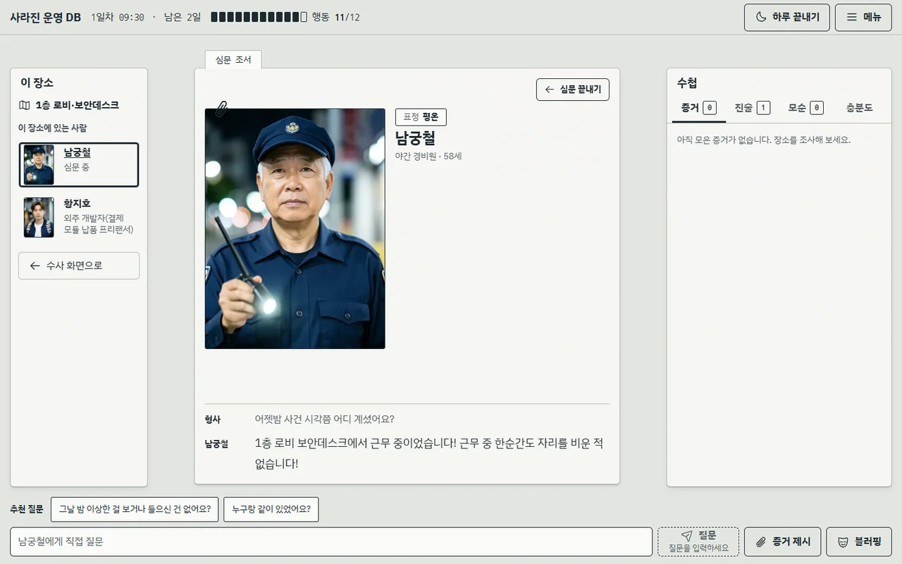

# The Suspects 웹 프론트엔드

Vite + React + TypeScript로 만든 추리 게임 화면입니다. 백엔드(FastAPI)와는 REST와 SSE(AG-UI 이벤트 형식)로 통신합니다.
화면 디자인은 "수사 기록철" 콘셉트(조서·도장·포스트잇, `docs/art-style.md`)이고 밝은/어두운 테마와 휴대폰 화면을 지원합니다.



## 실행 방법

`apps/web`에서 실행합니다. Node 20 이상이 필요합니다.

```bash
npm install
npm run dev        # 개발 서버 http://localhost:5173 ( /api 는 http://localhost:8000 으로 프록시 )
npm run dev:mock   # 백엔드 없이 가짜 데이터(목 모드)로 끝까지 플레이
npm run build      # 타입 검사 + 프로덕션 빌드
npm test           # vitest
npm run lint       # oxlint
```

목 모드는 `VITE_USE_MOCK=1`일 때 켜집니다. `npm run dev:mock`은 `.env.mock`을 읽어 이 값을 설정합니다.
목 모드는 AI 사진 없이 코드로 그린 얼굴(SVG)로 나옵니다.

## 폴더 구조

| 경로 | 내용 |
|:--|:--|
| `src/api/` | 계약 타입(`types.ts`), REST·SSE 클라이언트(`client.ts`, `sse.ts`), JSON Patch(`jsonpatch.ts`), 목 백엔드(`mock.ts`) |
| `src/state/` | AG-UI 이벤트를 화면 상태로 바꾸는 리듀서(`reducer.ts`)와 게임 훅(`useGame.ts`: 행동, 초상화 상태 묻기, 추천 질문 미리 만들기 알림) |
| `src/character/` | 초상화(`Portrait.tsx`: AI 사진 + 표정 사진 교차 전환, 없으면 시드로 그리는 SVG `faceRender.ts`) |
| `src/components/` | 상태 띠(`StatusStrip`), 지도(`MapPanel`), 장소 카드(`PlaceCard`), 심문 조서(`Dossier`), 행동 바(`ActionBar`), 수첩(`NotebookPanel`), 증거 카드, 대사 찍기(`DialogueBox`), 블러핑 창, 팝오버·시트, 오버레이(컷인·알림), 아이콘 |
| `src/screens/` | 시작, 사건 생성 대기, 브리핑, 메인(수사·심문), 최종 추리, 결과 카드, 클리어 이력, 정보·라이선스 |
| `src/styles/` | 디자인 토큰(`tokens.css`)과 화면별 스타일 |
| `src/util/` | 지도 칸 겹침 풀기(`layout.ts`), 시간·조사·공유 문구(`format.ts`), 결과 카드 PNG(`cardImage.ts`), 브라우저 저장, 화면 너비 |

## 응답 속도 관련 동작

- **첫 문장부터 보여 주기:** 서버는 인물 답을 문장 단위로 보낸다(`TEXT_MESSAGE_CONTENT`가 몇 초 간격으로 올 수 있음). 화면은 `TEXT_MESSAGE_END`까지 대사를 진행 중으로 둔다.
- **추천 질문 미리 만들기:** 심문을 시작할 때와 행동이 끝날 때마다 `POST /api/games/{id}/prepare`로 심문 중인 인물을 알린다. 서버가 그 인물의 추천 질문 답을 미리 만들어 두어, 앞 답을 읽은 뒤 누르면 바로 답이 나온다.
- **글자 찍기:** 한 글자 30ms. 밀린 글자가 많으면 한 번에 여러 글자씩 찍어 1.2초 안에 따라잡는다.

## 백엔드 계약

- API 계약: 저장소 루트의 `docs/api-contract.md`
- 데이터 모델: `server/schemas.py`의 `PlayerView` 이하 모델
- 화풍: `docs/art-style.md`

클라이언트는 `PlayerView`만 받습니다. 범인이나 비밀 정보는 화면 코드에 없습니다.

## 참고

- 서버의 이어하기 목록(`GET /api/games`)을 받지 못하면 이 브라우저에 기억해 둔 저장본을 대신 보여 줍니다.
- 결과 카드 PNG는 브라우저 캔버스에서 만들며 서버에 저장하지 않습니다. 인물 사진은 클리어할 때 남긴 썸네일(`ClearHistory.characters[].portrait_url`)을 쓰고, 없으면 코드로 그린 얼굴을 씁니다.
- 아이콘(Phosphor, MIT)과 글꼴(IBM Plex Sans KR, 나눔고딕코딩, OFL)의 라이선스 원문은 `public/licenses/`에 있습니다.
